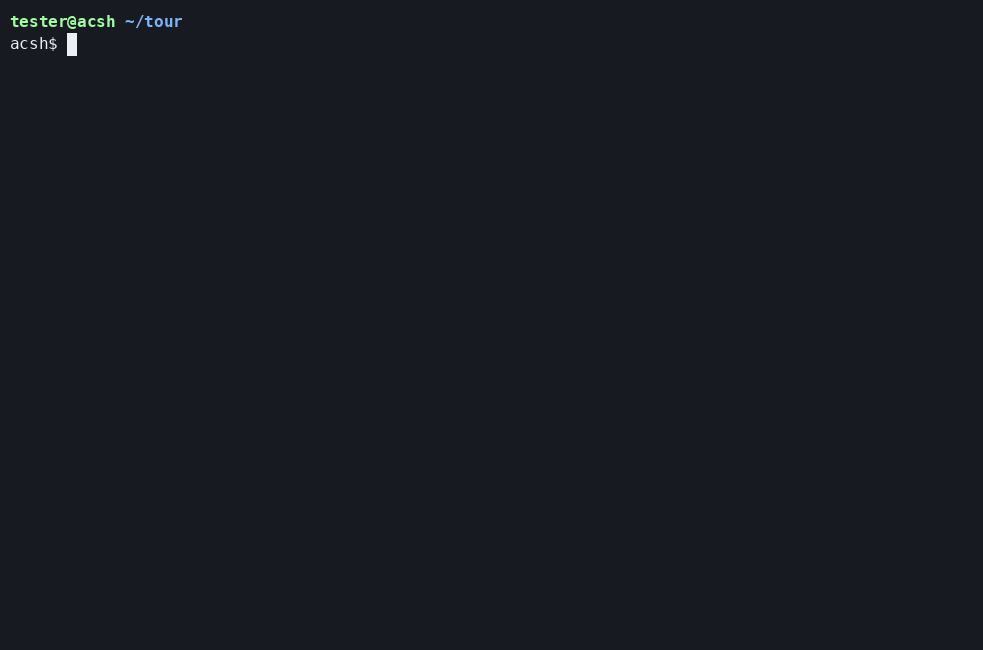
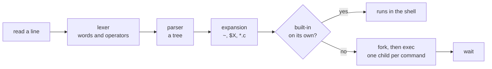

# acsh

acsh is a Unix shell in C with its own parser, job control and line editor. `explain` shows the system calls it makes for each command.

[](https://github.com/An3DCu/CustomShell/actions/workflows/ci.yml) [](LICENSE) [](https://en.cppreference.com/w/c/17)



## Overview

I use a shell every day. Each command I type goes through fork, exec, pipes and signals. None of that shows. acsh is how I found out what happens in between.

It runs programs and pipelines with every kind of redirection. It expands variables and file name patterns. It has if, while and for. It runs scripts. At a terminal it adds job control and a line editor with history and Tab completion. No library does that work. The parser, the pattern matcher and the line editor are my own code.

What I'd want a reviewer to notice is explain mode. With `explain` in front of a command, acsh prints the plan it parsed. Then it prints every pipe, fork, dup2 and exec as it happens. The GIF above shows it on a pipeline.

Under that are 982 tests. Many of them compare acsh with dash, bash or GNU coreutils on the same input. CI runs them with gcc and clang, under AddressSanitizer and UBSan, and under valgrind with every process checked for leaks. Every pull request also fuzzes the parser and runs two static analyzers.

## Features

- **Pipelines and redirections:** `a | b | c` with `<`, `>`, `>>`, `<&` and `>&`, and any fd in front (`2>err`, `2>&1`, `3<&-`).
- **Lists:** `;`, `&&`, `||`, `&` and `!`, with comments and `\` at the end of a line.
- **Variables:** shell and exported variables, `X=1 cmd`, `$?`, `$$`, `$!`, `$#`, `$0` to `$9`, `$@` and `$*`.
- **Expansion:** `~`, `$X` and `${X}`, field splitting on IFS, and file name patterns (`*`, `?`, `[a-z]`, `[[:alpha:]]`).
- **Control flow:** `if`, `elif`, `else`, `while`, `until` and `for`, with `break` and `continue`.
- **Scripts:** `acsh file`, `acsh -c`, `source` and `.`, `#!` lines, `shift` and `read`.
- **Job control:** `cmd &`, Ctrl+Z, `jobs`, `fg`, `bg`, `kill`, `wait` and `disown`, with notices like `job 1 done: sleep 30 (exit 0)`.
- **Line editor:** emacs keys, history in `~/.acsh_history`, Ctrl+R search, and Tab completion that cycles through the matches.
- **Explain mode:** `explain cmd` for one line, `acsh --explain` or `set -o explain` for every line.
- **Errors:** `acsh: what: why`, with the line number in a script. At a terminal, a short hint follows a few common mistakes.
- **My own tools:** `cat`, `head`, `wc`, `touch`, `mkdir` and `ls` in `tools/`. `acsh --own-tools` puts them first in PATH.

## Tech stack

| Piece | Choice | Why |
|---|---|---|
| Language | C17 and POSIX.1-2008 | The same code builds with gcc and clang, without extensions |
| Build | make, with every warning an error | `-Wall -Wextra -Wpedantic` plus six more, listed in the Makefile |
| Line editor | My own, on termios raw mode | No readline, so every key and redraw is in this repo |
| Unit tests | My own small harness in C | A few macros in `tests/unit/check.h` are all the unit tests need |
| End-to-end tests | pytest and pexpect, pinned | pexpect runs acsh in a pseudo-terminal. Ctrl+C and Tab only mean something in a terminal |
| Memory | AddressSanitizer, UBSan, valgrind | Bad reads, undefined behavior and leaks fail the tests |
| Fuzzing | libFuzzer with clang | The lexer and parser get any bytes at all, from a saved corpus |
| Static analysis | gcc -fanalyzer, clang-tidy | Zero warnings. Each check that's off has its reason in `.clang-tidy` |
| Container | Docker, on a pinned Ubuntu 26.04 | Builds and tests acsh without a Linux machine |
| CI | GitHub Actions, in that image | Seven required jobs on every pull request, actions pinned by commit |

## How it works

A line goes through the same steps wherever it comes from, the terminal, a pipe or a script.



The lexer keeps every word as typed, quotes included. The parser builds a tree of lists, pipelines and commands. Expansion comes last, right before a command runs. Each byte remembers whether it was typed, came from a variable or sat inside quotes. That's why a variable's value is never read as shell code.

A built-in on its own runs inside the shell. `cd` and `exit` only work there. Everything else gets one child per command, connected by pipes. The shell closes every pipe end it doesn't need. Otherwise `yes | head -n 1` would never finish.

At a terminal, each pipeline gets a process group of its own. That group has the terminal while it runs. Ctrl+C and Ctrl+Z then reach the pipeline instead of the shell. A background job that ends wakes the prompt through a self-pipe. Its notice comes right before the next prompt.

While you type, the terminal is in raw mode. acsh reads one key at a time and draws the line itself with ANSI codes. Raw mode ends before a command runs. A signal that would end acsh puts the terminal back first.

[docs/how-it-works.md](docs/how-it-works.md) goes through each of these step by step.

## Getting started

### With Docker

This works the same on Windows, macOS and Linux.

```powershell
git clone https://github.com/An3DCu/CustomShell.git
cd CustomShell
docker build -t acsh .
docker run --rm -it acsh
```

The image has acsh built. `docker run` starts it. `exit` or Ctrl+D leaves. To run every test in the image:

```powershell
docker run --rm acsh make test
```

### On Linux or WSL

You need gcc or clang, make, and Python 3 with venv for the tests. On Ubuntu:

```bash
sudo apt install build-essential clang python3-venv
git clone https://github.com/An3DCu/CustomShell.git
cd CustomShell
make
build/acsh
```

### Tests

```bash
make test             # unit tests, then end-to-end tests
make test-debug       # the same, built with AddressSanitizer and UBSan
make test-valgrind    # every process under valgrind (needs valgrind)
make fuzz             # two minutes of fuzzing (needs clang)
make analyze          # gcc -fanalyzer and clang-tidy (needs clang-tidy)
```

The first `make test` makes a venv in `.venv/` and installs pytest and pexpect into it. `make CC=clang test` uses clang.

## Key engineering decisions

| Decision | Why | Trade-off |
|---|---|---|
| A tree before anything runs | `a \| b && c > f` has an order that's easy to get wrong token by token. The same tree is explain's plan | More code than running the tokens directly |
| Words keep their quotes until expansion | Every byte remembers where it came from. `X='a; rm -rf ~'; echo $X` prints the text and runs nothing | Expansion tracks an origin for each byte |
| My own line editor on termios | Every key, redraw and terminal mode is in the code | An emacs subset only. The cursor moves by byte |
| My own pattern matcher | It has to know which `*` was quoted. glob(3) only gets a string | No `**` or `{a,b}` |
| SIGINT blocked, let in only by pselect | A Ctrl+C between printing the prompt and starting to read can't get lost | Every wait at the prompt has to go through pselect |
| A self-pipe for SIGCHLD | The handler only writes one byte. Jobs are collected in the main loop | Two more fds, kept at 10 or above |
| Reading input one byte at a time | acsh never takes input meant for a command. In `printf 'cat\nhello\n' \| acsh`, cat gets "hello" | One read() per byte |
| Explain lines from a child go through a close-on-exec pipe | The shell reads them before it goes on. The lines come in the order things happened | A pipe for each child while explain is on |

## Where acsh differs from POSIX sh

- **Not in acsh yet:** command substitution (`$(...)` and backquotes), `$((...))`, functions, `case`, subshells and `{ }` groups, here-documents, `${X:-word}` and the other `${...}` forms, `trap`, `eval`, `exec`, `umask` and `alias`. Each one gives an error instead of running wrong.
- **Taken from bash:** `source`, `echo -n -e -E`, `kill -SIGTERM` with lowercase names too, `history`, and the warning on `exit` with stopped jobs.
- **acsh's own:** explain mode, job notices in words (`job 2 stopped: vim notes.txt`), the two-line prompt that shows a failed exit status, and hints under some errors.
- **Zero bytes** in the input are dropped with one warning. bash and dash drop them quietly.
- **Nesting** deeper than 1000 levels is a syntax error.
- **`set`** only knows `-o explain` and `+o explain`, besides setting `$1`, `$2` and the rest.

## Limitations

- Built and tested on Linux only. `--own-tools` finds the tools through `/proc/self/exe`.
- The line editor moves the cursor one byte at a time. A letter like č is two bytes. It takes two presses of Left or Backspace.
- My `ls` and `wc` measure column widths in bytes. A UTF-8 name takes more room than it needs.

## Roadmap

- [ ] `$(...)` and backquotes
- [ ] One cursor step per UTF-8 character in the line editor
- [ ] acsh in a sandbox, to try from my portfolio site

## Credits and license

- acsh started as a small shell I wrote by hand for a university course at IBU (International Burch University). It had no pipes. Ctrl+C killed it. I came back to it with more experience and an AI agent to work with. I rebuilt it from scratch. I made every call and reviewed every change.
- The end-to-end tests use [pytest](https://pytest.org/) (MIT) and [pexpect](https://github.com/pexpect/pexpect) (ISC).
- My code is under the MIT license. See [LICENSE](LICENSE).

## Contact

Anad Čuruković · [an3dcu.github.io](https://an3dcu.github.io) · [LinkedIn](https://linkedin.com/in/anadcurukovic) · ancur26@proton.me
